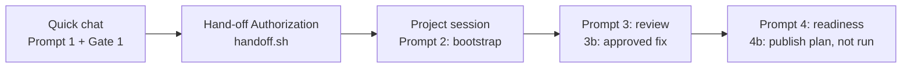

# Turn Any Idea into a Hands-on GitHub Exercise

A presenter kit for a live, 60-minute introductory workshop on the [gh-skills-builder](https://gh.io/gh-skills-builder) plugin for GitHub Copilot.

On stage, you turn an idea into *Cleared for Takeoff: A Copilot Quick-Start*, a small GitHub Skills exercise built on the [Tailspin Toys](https://github.com/github-samples/tailspin-toys) sample app. Along the way you show every part of the plugin: its one agent, `@github-skills-orchestrator`, and its five skills.

| | |
| --- | --- |
| **Format** | Presenter-led live walkthrough; the slides set the stage. Attendees watch and can repeat the prompts later. |
| **Audience** | Anyone who teaches, onboards, or shares technical knowledge: educators, open source maintainers, hackathon organizers, DevRel, startups, and enterprise enablement teams. |
| **Live result** | A 15–20-minute learner exercise with three graded steps and workflow-backed feedback, plus a clear view of the human approvals around it. |
| **Timing** | 45 minutes of content, a 5-minute flex buffer, and 10 minutes of protected Q&A. |

## Agenda

| Time | Segment | Plugin feature | Slides |
| --- | --- | --- | --- |
| 0:00–0:06 | Set the stage | Plugin install, one agent and five skills | 1–8 |
| 0:06–0:12 | Phase I: outline and Gate 1 | `/create-github-skills-outline` | 9 |
| 0:12–0:16 | Hand-off Authorization | `handoff.sh` creates the private authoring repo | 9 |
| 0:16–0:27 | Phase II: bootstrap and one fail-to-pass check | `/bootstrap-github-skills-exercise` | 10 |
| 0:27–0:35 | Phase III: report-only review and one approved fix | `/review-github-skills-exercise` | 11 |
| 0:35–0:41 | Phase IV: release readiness, no publication | `/publish-github-skills-exercise` | 12 |
| 0:41–0:45 | Recap | `/orchestrate-github-skills-exercise`, shown but not run | 13 |
| 0:45–0:50 | Flex buffer | Absorbs overruns; otherwise Q&A starts early | 13–14 |
| 0:50–1:00 | Protected Q&A | Plugin link and QR code | 14 |

Every live segment has a hard stop and a rehearsed fallback. The [run of show](run-of-show.md) is the authoritative timing; if anything else disagrees with it, follow the run of show.

## What learners build

The exercise teaches a new Tailspin teammate three Copilot customization habits. Validation checks what each learner wrote, not just whether a file exists.

1. Add a TSDoc convention to `.github/copilot-instructions.md`.
2. Give the existing `quality-checks` skill an evidence-based reporting format.
3. Create a report-only QA agent in `.github/agents/qa.agent.md`.

Filtering features, Plan and Autopilot practice, Agent Merge, and MCP are mentioned as extensions only. Phase III includes an optional read-only browser canvas prompt to preview the exercise README and all steps; it adds no learner requirement.

## Session flow and approvals



Use one quick chat for the outline and the hand-off, then one project session for Phases II–IV. Each approval grants one thing:

| Approval | Grants | Side effect |
| --- | --- | --- |
| Gate 1 | The outline, title, and repository name | None |
| Hand-off Authorization | One run of `handoff.sh` | A private authoring repo with the Tailspin starter commit, pushed |
| Gate 2 | Acceptance of the build, before review | None |
| Fix round (Prompt 3b) | One targeted fix for a real finding | Edits in the authoring repo |
| Gate 3 | Readiness materials for a reviewed build | None |
| Publication authorization | Publishing a public learner template | **Never given on stage** |

Review is report-only. It changes nothing until you approve a separate fix round.

## What's in this repository

| Path | Use it for |
| --- | --- |
| [`run-of-show.md`](run-of-show.md) | Everything you need on stage: agenda, slide cues, speaker notes, every prompt and command, hard stops, and fallbacks |
| [`demo-prestage-checklist.md`](demo-prestage-checklist.md) | Rehearsal, fallback preparation, and day-of checks |
| [`handoff.sh`](handoff.sh) | Creates the private authoring repo and imports the Tailspin starter |
| `gh-skills-builder-workshop-light.pptx`<br>`gh-skills-builder-workshop-dark.pptx` | Decks with the same content: 14 presented slides plus a hidden backup title slide (15). Speaker notes are synced from `run-of-show.md`. |
| `gh-skills-builder-workshop-dark.bento.html` | The same 14 slides as a single-file [Bento](https://bento.page) deck that runs in a browser, with the dark deck's artwork and the same speaker notes. Generated; see [Rebuilding the decks](#rebuilding-the-decks). |
| [`site/`](site/index.html) | The public workshop website: install steps, agenda, scenario, every prompt with a copy button, the hand-off script, and the slides. See [Workshop website](#workshop-website). |
| [`visuals/`](visuals/slide-placement.md) | Slide artwork, the plugin QR code, and placement notes |
| [`fallback/`](fallback/README.md) | Saved rehearsal outputs for each hard stop |
| [`clips/`](clips/README.md) | Local-only fallback recordings (git-ignored) |
| [`build/`](build/README.md) | Scripts to rebuild, validate, and preview the decks and the website |
| [`.github/workflows/pages.yml`](.github/workflows/pages.yml) | Checks the website against `run-of-show.md` and publishes it to GitHub Pages |

## Prepare

1. Install the plugin:

   ```bash
   copilot plugin install gh-skills-builder@awesome-copilot
   ```

   If the marketplace isn't registered yet, first run `copilot plugin marketplace add github/awesome-copilot`. In the Copilot app, confirm that `@github-skills-orchestrator` and the five slash commands are available.
2. Clone this repository. The prompts refer to its absolute path as `<workshop-repo>`, because a quick chat has no working directory.
3. Work through the [pre-stage checklist](demo-prestage-checklist.md):
   - dry-run `handoff.sh`;
   - build the rehearsal project and its checkpoint branches;
   - save the fallback files;
   - record the clips.
4. Rehearse the whole session with a stopwatch. Content must end by 0:45.

## Deliver

- Present the light or dark PowerPoint deck, whichever suits the room, or the [Bento deck](#the-bento-deck) if you'd rather present from a browser.
- Follow the [run of show](run-of-show.md). It has every slide cue, speaker note, prompt, and command, so you don't need presenter view or any other file. View it on GitHub so each prompt has a copy button.
- Use **Interactive** mode throughout:
  - **Auto → Intelligence** for the outline quick chat;
  - **Auto → Balance** for the project session, if those controls are available.
- Respect the hard stops. If you fall behind, cut in the order listed in the run of show.
- Start Q&A by 0:50 no matter what.

## The hand-off script

```bash
<workshop-repo>/handoff.sh <owner> copilot-app-cleared-for-takeoff [parent-dir]
<workshop-repo>/handoff.sh --dry-run <owner> copilot-app-cleared-for-takeoff [parent-dir]
```

The script:

1. Creates `<owner>/<name>` as a **private** repository with `gh` and clones it under `parent-dir` (default `~/src/workshop-demo`).
2. Imports a shallow copy of Tailspin Toys as one MIT-licensed starter commit.
3. Pushes `main`.

It leaves out:

- the upstream issue sources and the workflow that seeds them;
- the maintainer triage workflow;
- CODEOWNERS.

As a result, the exercise's Step 0 opens only its own instructions issue.

`--dry-run` builds the same commit in a local repository without creating or pushing anything on GitHub. It still clones Tailspin, so it needs a network connection. The script requires an authenticated `gh`, `git`, and `rsync`.

## The Bento deck

`gh-skills-builder-workshop-dark.bento.html` is one self-contained HTML file: the Bento app, the slides, the images, and the fonts. It works offline, with no install. Reveal.js runs the presentation.

1. Open the file in Chrome or Edge, then present it.
2. Press <kbd>S</kbd> for the speaker view with notes, <kbd>F</kbd> to toggle full screen, and <kbd>Esc</kbd> to stop.
3. Advance with the arrow keys, a clicker, or a swipe. Clicking a slide does not advance it, and the on-screen arrows are hidden so they don't cover the slide.

The deck is generated from the dark PowerPoint deck and the run of show. Changes made in the Bento editor are overwritten by the next build, so make them in `build/build-bento.py` instead.

## Workshop website

[`site/`](site/index.html) is a static, single-page site for attendees: what the plugin is, how to install it, the agenda, the scenario, the approval gates, every prompt with a copy button, the hand-off script to download, the slides, and links to go further. It has no build step and no dependencies.

- **Preview it:** `python3 -m http.server --directory site 8000`, then open <http://localhost:8000>.
- **Publish it:** in **Settings → Pages**, set **Source** to **GitHub Actions**. The [workflow](.github/workflows/pages.yml) checks every pull request that touches the site and deploys each push to `main`. The site is public even though this repository is private, and Pages for a private repository needs a paid plan.
- **Keep it in sync:** the prompts and `site/downloads/handoff.sh` are copied from `run-of-show.md` and `handoff.sh` by `python3 build/sync-site.py`. The workflow fails if you forget.

The embedded slides are a read-only copy of the Bento deck, without speaker notes. The page's social preview image uses the absolute URL `https://arilivigni.github.io/gh-skills-builder-workshop/`; update `og:image` in `site/index.html` if the site moves.

## Rebuilding the decks

The committed decks are ready to present. Speaker notes come from [`run-of-show.md`](run-of-show.md). After editing it, run:

```bash
python3 build/sync-notes.py   # notes in both PowerPoint decks
python3 build/build-bento.py  # Bento deck and website slides
python3 build/sync-site.py    # website prompts and handoff.sh copy
```

Slide 1 (the 2026 template title slide) and the hidden slide 15 were edited by hand after the last build. Rerunning `build/build-workshop-v2.py` overwrites them, so follow [`build/README.md`](build/README.md) before you rebuild. The GitHub presentation template the decks are built on is not included.

## Credits

- **gh-skills-builder plugin:** [arilivigni/gh-skills-builder](https://github.com/arilivigni/gh-skills-builder), listed at [gh.io/gh-skills-builder](https://gh.io/gh-skills-builder).
- **Tailspin Toys:** [github-samples/tailspin-toys](https://github.com/github-samples/tailspin-toys), MIT License. It is not included here. `handoff.sh` fetches it into your authoring repository, together with its license.
- **Scenario inspiration:** the [Dev Days Copilot app lab](https://github-samples.github.io/copilot-workshops/real-world-development/app/).
- **Slide artwork:** generated with Google Gemini.
- **Hubot Sans:** SIL Open Font License 1.1, bundled in `build/fonts/` with its license.
- **Mona Sans:** [github/mona-sans](https://github.com/github/mona-sans), SIL Open Font License 1.1, bundled in `site/assets/fonts/` with its license and embedded in the Bento deck.
- **Bento:** [bento.page](https://bento.page), MIT License. Its app is embedded in each `.bento.html` file.
- **Slide design:** the 2026 GitHub Presentation Template.
